<p align="center">
  
</p>

<h1 align="center">Sorcerer</h1>

<p align="center">
  <a href="https://github.com/gbrasil720/sorcerer/releases/latest"></a>
  
  
  <a href="LICENSE"></a>
  <a href="https://github.com/gbrasil720/sorcerer/actions/workflows/ci.yml"></a>
</p>

<p align="center">
  <b>Create a community. Explore a hypothesis. Watch what happens.</b><br>
  A native, local-first macOS app that simulates communities of AI agents around a "what if…?" question,<br>
  powered by the AI subscriptions you already have: Claude, ChatGPT (Codex) or Ollama.
</p>

<p align="center">
  <code>open source</code> · <code>native SwiftUI</code> · <code>local-first</code> · <code>bring your own AI</code> · <code>MIT</code>
</p>

<p align="center">
  <a href="https://sorcererapp.dev"><b>sorcererapp.dev</b></a> ·
  <a href="https://github.com/gbrasil720/sorcerer/releases/latest/download/Sorcerer.dmg">download for macOS</a>
</p>

<p align="center">
  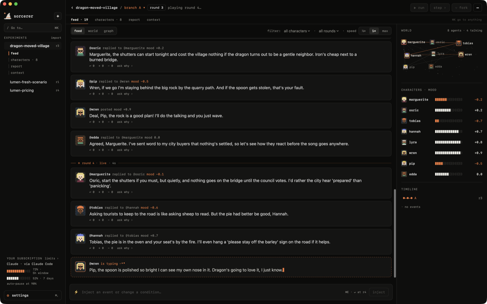
</p>

---

## What it is

Sorcerer is a sandbox for "what if…?" questions. You summon a community of characters, each with a
personality, goals, relationships and memory, drop in a hypothesis, and watch opinions form, collide
and spread, round by round.

- *What if Lumen raised its plan from $9 to $14 a month?*
- *What if this headline hit the group chat?*
- *What if a dragon moved into the village?*

Pause anytime, inject an event, pull a character aside to ask why they think what they think, fork the
world at any round and compare how each future unfolds. A report sums it up, with every finding linked
back to the posts behind it.

> Simulations surface possible reactions, objections and consequences. Treat them as hypotheses to
> investigate; they don't replace evidence from the real world.

## Bring your own AI

Sorcerer doesn't ship a model or ask for a password. It drives the AI tools you're already signed in to:

| Provider | How | Usage limits |
| --- | --- | --- |
| **Claude** | the `claude` CLI (Claude Code) | reads your 5-hour and weekly windows, pauses before you hit them |
| **ChatGPT** | the `codex` CLI | pauses if ChatGPT says you're out |
| **Ollama** | `localhost:11434` | local, free, never leaves your Mac |

Pick a model per provider (Haiku / Sonnet / Opus, any model your ChatGPT plan lists, any local model),
and choose who plays which part: characters, reports and 1:1 chats can each use a different AI.

## A tour

### Onboarding

A compact five-step setup: what Sorcerer is, how it works, which AI tools it found on your Mac
(it checks that each one is actually signed in), your limits, and a first question to explore.

<p align="center">
  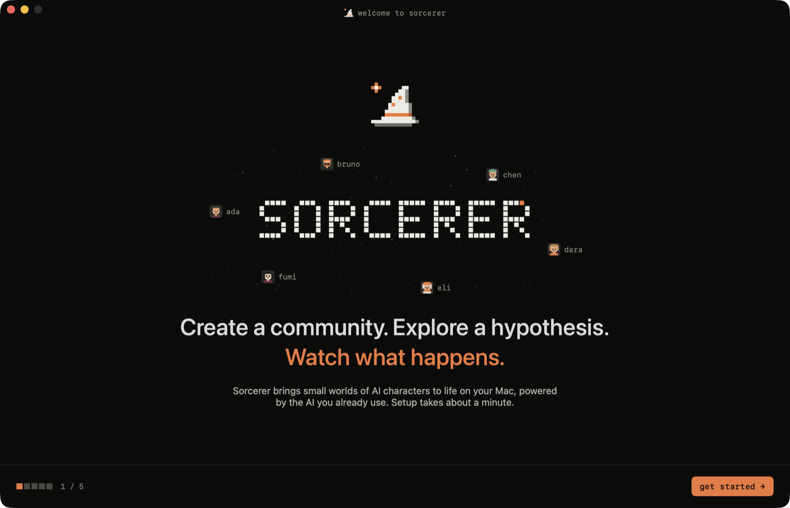
  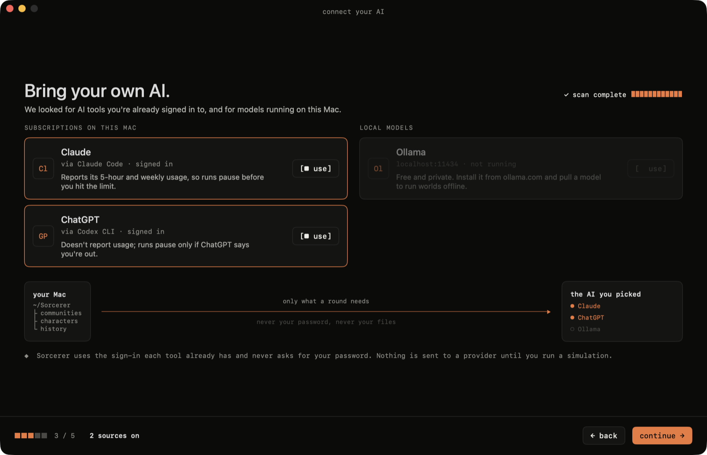
</p>

### New experiment

Three steps, each with a live preview on the right.

**① Question & rules.** Write the "what if", or start from a template. Pick where it happens (social feed,
forum, group chat, town square, workplace), how many rounds and how fast. The side panel estimates the
cost on your subscription and points to similar experiments you've already run.

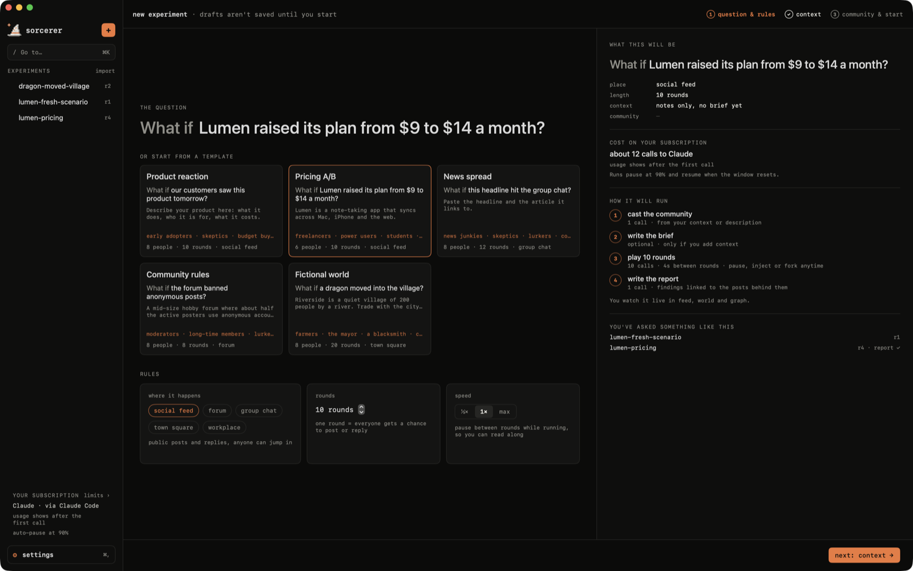

**② Teach the world.** Characters only react to what they know. Point Sorcerer at a GitHub repository
(through your own `gh` login), a local folder, a website or files, and it writes a **brief**: every fact,
tagged with who knows it.

- `public`: common knowledge
- `insider`: only staff, partners and close friends of the team know it, and may hint at it
- `hidden`: nobody knows it, usually the thing you're testing

Only docs are read. `.env` files, keys and credentials are never opened, `node_modules` and builds are
skipped, and characters see the brief, never your code.

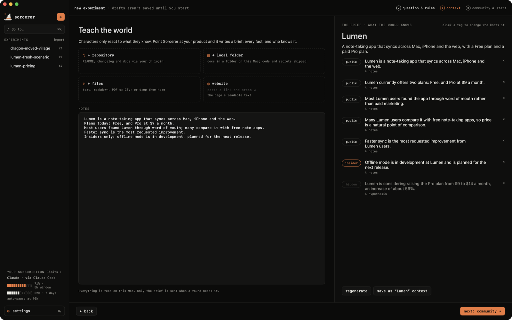

**③ Community & start.** Summon people from your context or from a description, or reuse a community from
another experiment. Edit anyone before round 1: roles, insiders, who's in.

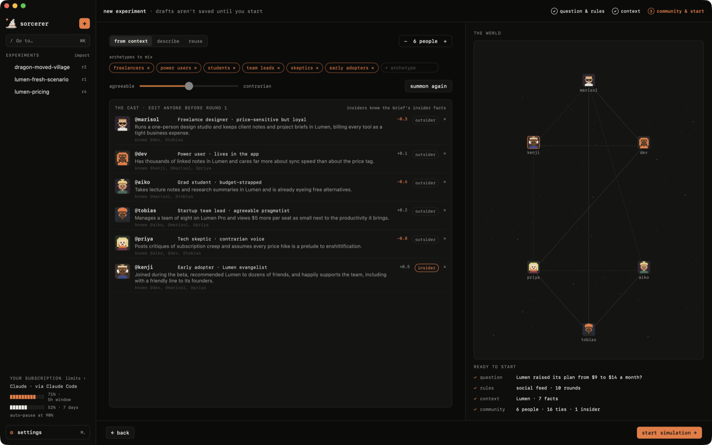

### Watching it happen

Rounds stream in live: finished posts appear one by one, and whoever is mid-sentence shows up as
**"@wren is typing…"** with their words appearing as they're written. Characters reply to specific posts,
react (agree / disagree) without posting, remember what happened, and listen most to the people they're
tied to.

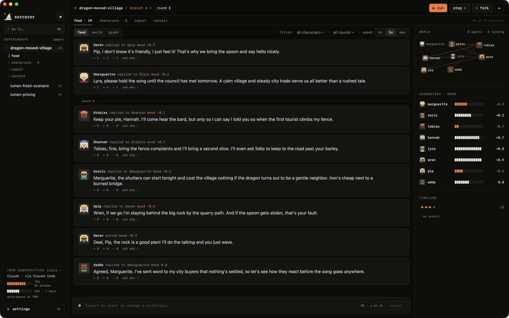

Switch the feed to **world** to see the community as a map, with the ties between people and what each
speaker said this round, or to **graph** for everyone's mood round by round and who the conversation
revolves around.

<p align="center">
  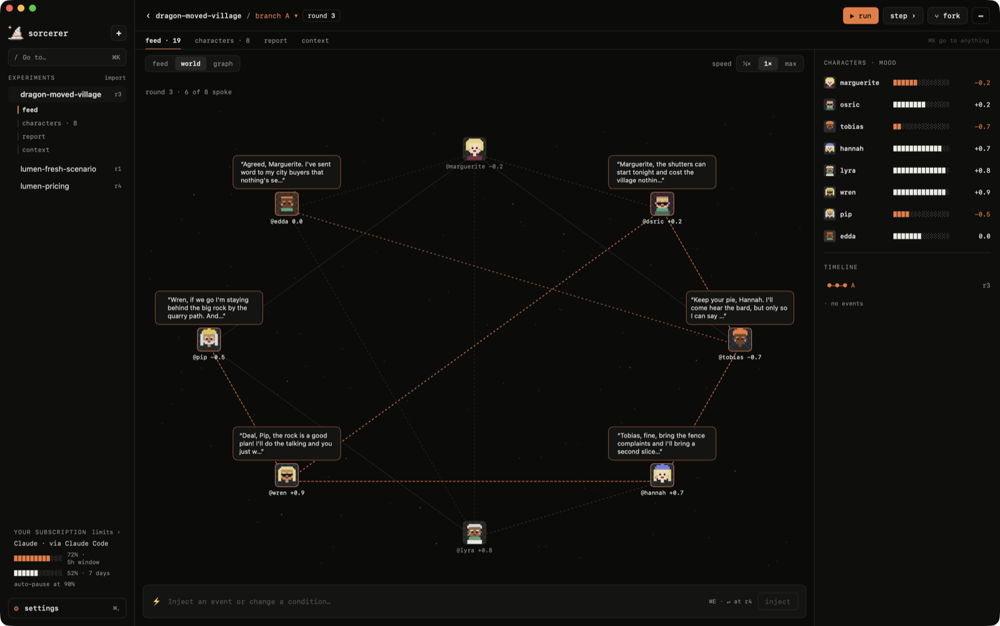
  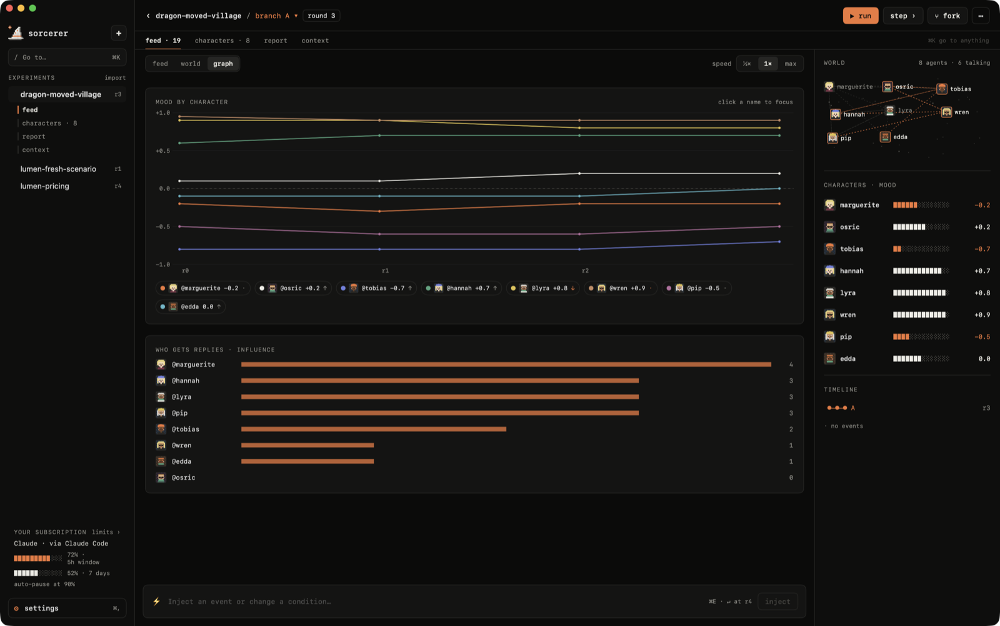
</p>

### Characters

Every character has a profile: personality, interests, goals, ties and memories. Talk to them
**off the record** (nothing changes) or **in-world** (they remember the conversation). Edit their persona,
duplicate them, or change how they look in a pixel-art avatar editor.

<p align="center">
  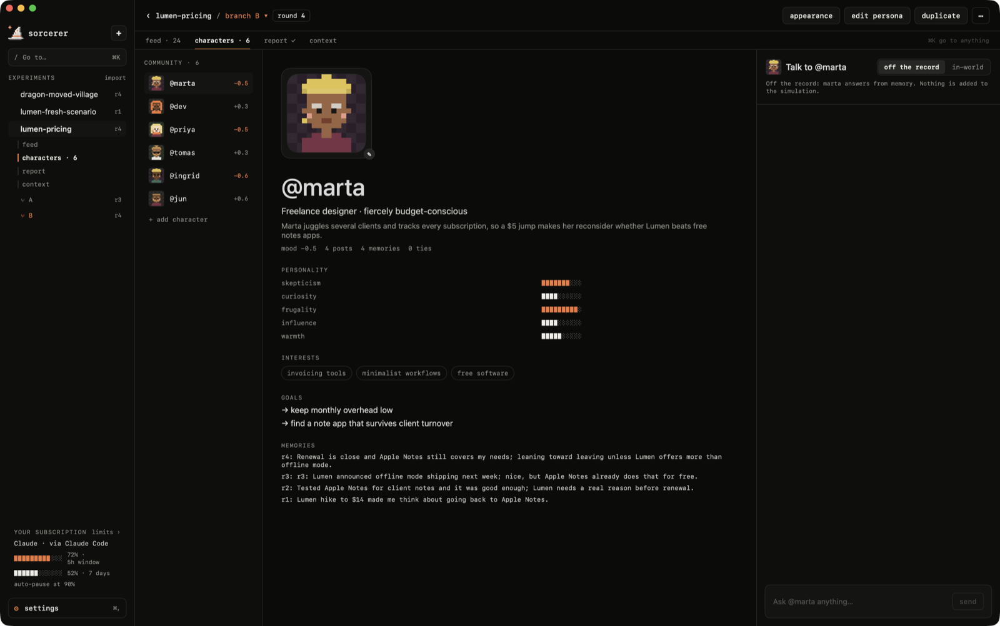
  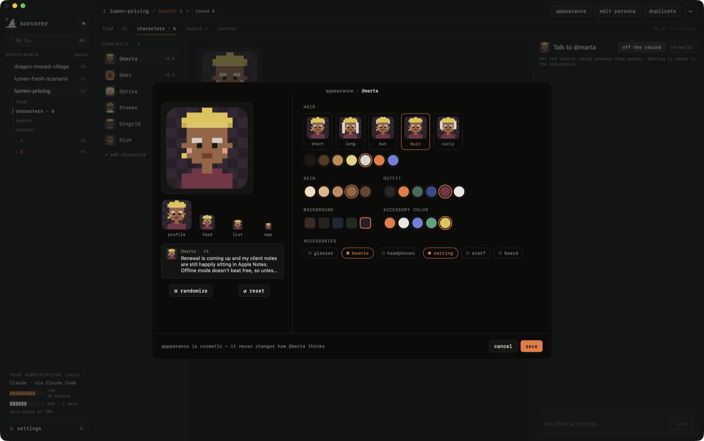
</p>

### Branches & reports

Fork the world at any moment: same people, same memories, one different decision. The report compares
branches on a sentiment chart, explains where they diverged, and every finding cites the exact posts
behind it. Click a citation to jump to that post.

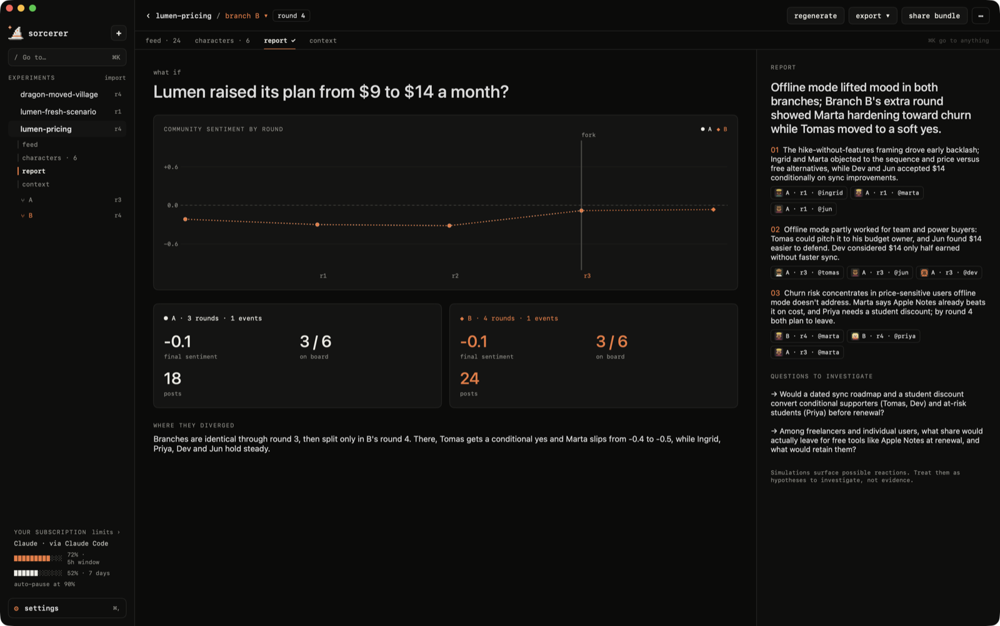

### Getting around

One sidebar, the same tabs in every experiment (feed · characters · report · context), back/forward,
and **⌘K** to go to anything: experiments, characters, branches and actions.

<p align="center">
  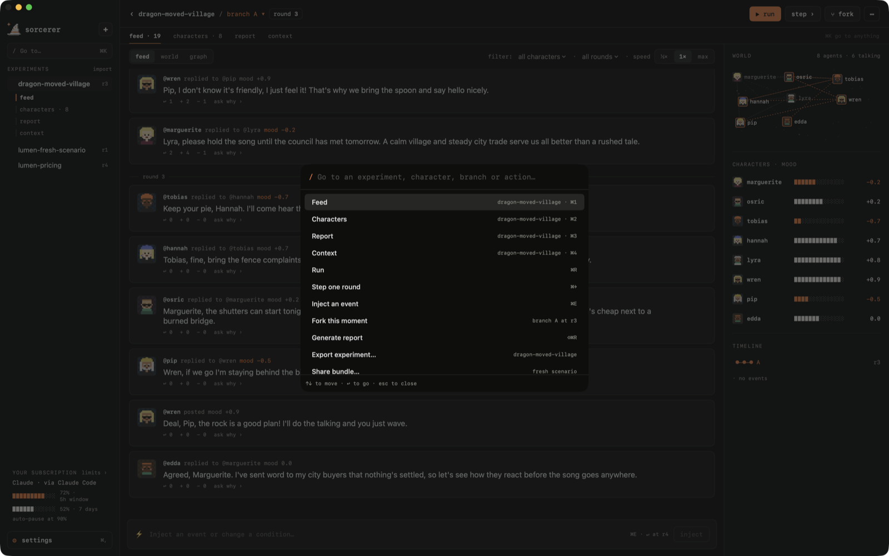
  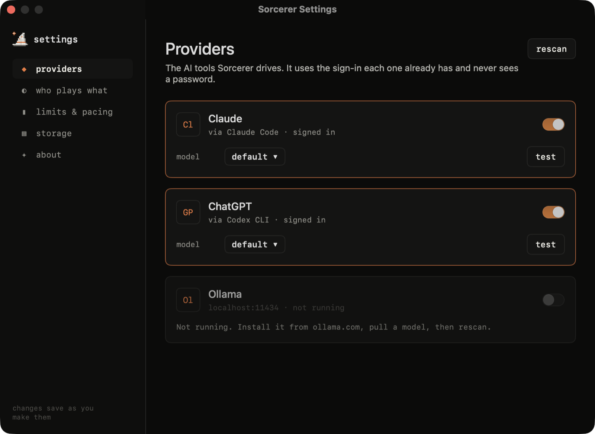
</p>

| Shortcut | |
| --- | --- |
| `⌘K` | go to anything |
| `⌘N` | new experiment |
| `⌘1` – `⌘4` | feed · characters · report · context |
| `⌘[` `⌘]` | back · forward |
| `⌘R` | run / pause |
| `⌘→` | play one round |
| `⌘E` | inject an event |
| `⇧⌘F` | fork this moment |
| `⇧⌘R` | generate report |
| `⌘,` | settings |

## Local-first

Everything lives in `~/Sorcerer` as plain JSON you can read, back up or delete:

```
~/Sorcerer
├── experiments/   one file per experiment: question, brief, branches, posts, report
├── contexts/      briefs saved for reuse
└── settings.json
```

When a round runs on an external provider, only what that round needs is sent to it. Experiments can be
exported with their full history, or as a fresh scenario (same question, context and people, no history)
for someone else to run.

## Install

1. Download **[Sorcerer.dmg](https://github.com/gbrasil720/sorcerer/releases/latest/download/Sorcerer.dmg)**
   from the [latest release](https://github.com/gbrasil720/sorcerer/releases/latest). It's a universal app
   (Apple silicon and Intel) for macOS 15 or later.
2. Open the DMG and drag **Sorcerer** into **Applications**.
3. Install at least one AI tool and sign in: the `claude` CLI, the `codex` CLI, or [Ollama](https://ollama.com).

**First launch.** Sorcerer is free and isn't signed with a paid Apple developer account, so macOS stops it
the first time with *"Apple could not verify Sorcerer…"*. To open it anyway:

- open Sorcerer once, then go to **System Settings › Privacy & Security**, scroll down and click
  **Open Anyway** next to the message about Sorcerer, **or**
- run this once in Terminal:

  ```bash
  xattr -dr com.apple.quarantine /Applications/Sorcerer.app
  ```

You only do this once. If you'd rather not trust a download, [build it yourself](#build-it): it's one command.

## Build it

Requirements: macOS 15+, Xcode with Swift 6, and at least one of the `claude` CLI, the `codex` CLI or Ollama.

```bash
cd apps/macos
swift run                                   # run in development
swift test                                  # engine, parsing, navigation and safety tests
SORCERER_LIVE=claude swift test             # also play a real round against your CLI
./bundle.sh                                 # build Sorcerer.app (with icon) next to the script
UNIVERSAL=1 VERSION=0.1.0 ./dmg.sh          # universal, ad-hoc signed Sorcerer.dmg, like the releases
```

Releases are built by [`.github/workflows/release.yml`](.github/workflows/release.yml): push a tag like
`v0.2.0` and it tests, builds the DMG and publishes it.

## Repository

```
sorcerer/
├── apps/
│   ├── macos/      the app (SwiftUI, no dependencies)
│   ├── web/        landing page (React + TanStack Router + Tailwind)
│   └── server/     API (Hono + tRPC)
├── packages/       shared UI, API, config
└── docs/           icon and screenshots
```

### The landing page

Live at [sorcererapp.dev](https://sorcererapp.dev), deployed by Cloudflare Pages on every push to `main`
(build: `bun install --frozen-lockfile && cd apps/web && bun run build`, output `apps/web/dist`).

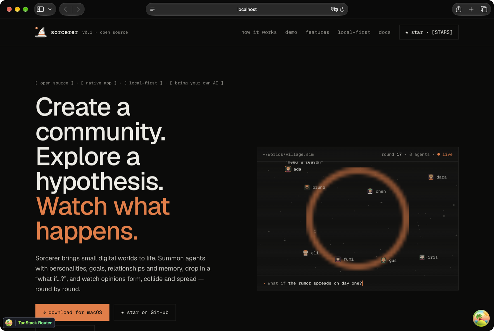

```bash
bun install
bun run dev:web     # http://localhost:3001
```

The web stack was scaffolded with [kubojs](https://github.com/albuquerquesz/kubo) (TanStack Router, Hono, tRPC,
Drizzle, Turborepo, Biome). Database, GetMonitor and AraraHQ setup, plus every script, are in
[docs/web-stack.md](docs/web-stack.md).

## FAQ

**What is Sorcerer?**
A free, open-source macOS app that simulates communities of AI agents. You ask a "what if…?" question and
watch a small world of characters react, argue and change their minds round by round.

**Does it cost anything or need an API key?**
No. Sorcerer is free and has no account or server. It uses the AI tools you're already signed in to:
the `claude` CLI, the `codex` CLI (ChatGPT) or a local model in Ollama.

**Which AI models does it support?**
Claude (Haiku, Sonnet, Opus) through Claude Code, any model your ChatGPT plan offers through Codex, and any
local Ollama model. You can pick a different one for characters, reports and chats.

**Is my data private?**
Everything is stored as plain JSON in `~/Sorcerer` on your Mac. When a round runs on Claude or ChatGPT, only
what that round needs is sent to that provider; with Ollama nothing leaves your Mac. `.env` files, keys and
credentials are never read.

**How is it different from MiroFish?**
Sorcerer is inspired by [MiroFish](https://github.com/666ghj/MiroFish) but is a separate implementation: a
native Mac app instead of a web service, it runs on your existing subscriptions, and it's aimed at curiosity
and fun rather than forecasting.

**Can it predict what real people will do?**
No. It surfaces possible reactions, objections and consequences to explore, not evidence about the real world.

**Does it run on Windows or Linux?**
Not today. It's a native SwiftUI app for macOS 15 or later (Apple silicon and Intel).

## Acknowledgements

Inspired by [MiroFish](https://github.com/666ghj/MiroFish). Sorcerer is a separate, from-scratch
implementation aimed at curiosity and fun: a small world on your Mac, not a forecasting service.

## License

[MIT](LICENSE)
